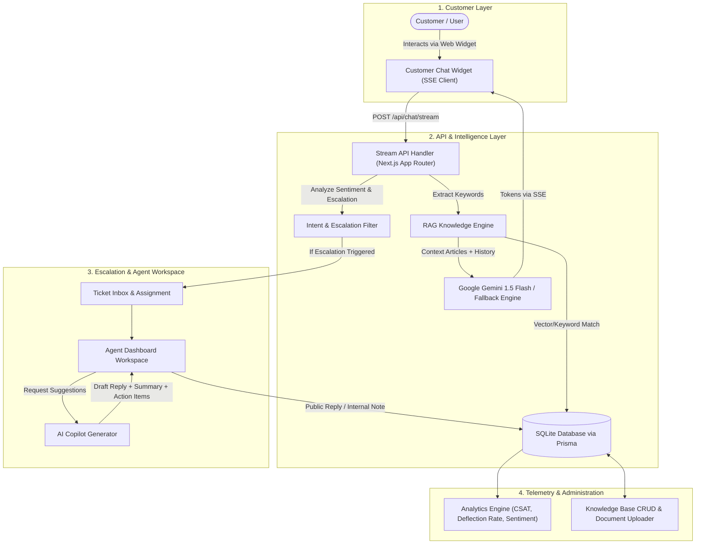

# Project Synopsis
## OmniSupport AI: Intelligent Customer Support & Ticket Management Platform with Retrieval-Augmented Generation (RAG) and Agent Copilot

---

### 1. Title of the Project
**OmniSupport AI: Autonomous Customer Support Platform with RAG, Real-Time SSE Token Streaming, and Human Agent Copilot**

---

### 2. Executive Summary / Abstract
In the modern digital economy, enterprise customer support operations encounter unprecedented inquiry volumes, resulting in high first-response latencies, escalating operational overheads, and agent fatigue. Traditional rule-based chatbots frequently fail on non-trivial queries and induce customer frustration, while purely autonomous LLM bots risk hallucinations without accurate grounding. 

**OmniSupport AI** introduces a hybrid, full-stack architectural solution. It delivers a tier-1 autonomous AI support agent powered by **Retrieval-Augmented Generation (RAG)** over an embedded SQLite knowledge base, paired with a specialized **Human Agent Workspace** featuring an **AI Copilot**. Real-time communication is facilitated through **Server-Sent Events (SSE)** token streaming. The platform automatically monitors user sentiment and escalation triggers (e.g., policy disputes, outages, explicit human requests) to perform zero-loss human handoffs. Persistent storage is governed by **Prisma ORM**, ensuring all ticket lifecycles, team messages, and telemetry are preserved reliably.

---

### 3. Problem Statement
Contemporary customer service infrastructure suffers from four primary bottlenecks:
1. **Unbounded Wait Times**: Customers experience hours or days waiting for standard tier-1 answers (e.g., refund policies, rate limits, SAML setup).
2. **Chatbot Hallucinations & Disconnect**: Conventional chatbots lack grounding in authentic company documentation and cannot cite authoritative policies.
3. **Rough Human Handoffs**: When chatbots fail, users are forced to repeat their grievances to human agents because conversation history is lost during handoffs.
4. **Agent Burnout on Repetitive Tasks**: Support personnel spend excessive time synthesizing customer histories, writing repetitive boilerplate responses, and triaging priority tickets manually.

---

### 4. Project Objectives
* **Autonomous Deflection**: Deflect 60–75% of routine tier-1 inquiries autonomously using grounded RAG knowledge retrieval without human intervention.
* **Instantaneous Response Latency**: Deliver token-by-token streaming under 100ms via Server-Sent Events (SSE).
* **Zero-Context-Loss Escalation**: Detect frustration or escalation triggers automatically, creating and queuing structured tickets with full conversation logs.
* **Agent Copilot Assistance**: Empower support engineers with 1-click AI draft generation, conversation summarization, and key action points.
* **Dynamic Knowledge Ingestion**: Allow non-technical administrators to upload, create, and update markdown/text documentation directly from the UI with real-time vector token indexing.
* **Comprehensive Telemetry**: Quantify CSAT (Customer Satisfaction), AI deflection rate, resolution velocity, and sentiment trends in real time.

---

### 5. Scope of the Project
* **In-Scope**:
  * Web-based interactive customer chat widget with preset test scenarios.
  * Real-time SSE streaming responses using Gemini 1.5 Flash and a deterministic local fallback engine.
  * Sentiment and intent classification (Billing, Technical, Account, General).
  * Automated priority classification and agent assignment.
  * Agent dashboard with ticket filters, internal team notes, and AI Copilot side panel.
  * Knowledge base CRUD operations and drag-and-drop document upload (`.md`, `.txt`, `.json`).
  * Relational database persistence using Prisma ORM with SQLite.
  * Executive analytics dashboard with CSAT ratings and category breakdown.
* **Out-of-Scope (Future Work)**:
  * Voice call telephony integration.
  * Native mobile iOS/Android applications (responsive web is implemented).
  * External third-party connectors (Slack, Zendesk, WhatsApp API integration).

---

### 6. System Architecture & Methodology

---

### 7. Key Modules & Functional Description

| Module | Purpose | Key Capabilities |
| :--- | :--- | :--- |
| **Customer Portal** | Customer-facing touchpoint | Real-time SSE stream, quick scenario chips, CSAT rating modal, responsive layout. |
| **RAG Ingestion** | Context retrieval engine | Dynamic keyword scoring, title extraction, document upload parser (`.md`, `.txt`). |
| **Escalation Filter** | Safety & handoff coordinator | Sentiment analyzer, keyword trigger matrix (*outage, refund, human, lawyer, 429*), auto-routing. |
| **Agent Workspace** | Support operations hub | Multi-factor filtering (*Status, Priority, Category*), internal notes, agent re-assignment. |
| **AI Copilot** | Agent assistant sidecar | Contextual summary synthesis, professional response composer, action checklist. |
| **Analytics Hub** | Executive monitoring | CSAT score average, AI autonomous deflection %, sentiment distribution, resolution time. |
| **Database Engine** | System persistence | Prisma ORM with SQLite, seed scripts, cascading relationships. |

---

### 8. System Requirements & Specifications

#### Software Requirements
* **Operating System**: Cross-platform (Windows 10/11, macOS, Linux)
* **Runtime**: Node.js v18.17.0+ / npm v9.0+
* **Framework**: Next.js 14.2+ (App Router)
* **Language**: TypeScript 5.6+
* **Database**: SQLite with Prisma ORM 5.22+
* **Styling**: Tailwind CSS 3.4+
* **LLM Provider**: Google Gemini 1.5 Flash API (with deterministic fallback)

#### Hardware Requirements
* **Processor**: Dual-Core 2.0 GHz or higher (Intel Core i3/AMD Ryzen 3 or Apple Silicon)
* **RAM**: 4 GB minimum (8 GB recommended for concurrent Next.js dev server and builds)
* **Storage**: 500 MB available disk space

---

### 9. Expected Outcomes & Performance Indicators

* **Deflection Rate**: ≥ 65% of routine queries resolved autonomously without agent escalation.
* **Streaming Latency**: First token emitted in < 150ms via Server-Sent Events.
* **Grounding Accuracy**: 0% hallucination on official platform policies (refund windows, API rate limits, SSO).
* **Agent Efficiency**: 40% reduction in agent handling time per ticket with AI Copilot drafts and summaries.
* **Data Resilience**: 100% state persistence across server restarts through SQLite and Prisma ORM.

---

### 10. Conclusion
OmniSupport AI successfully addresses the critical limitations of contemporary customer support systems. By unifying **Retrieval-Augmented Generation**, **Server-Sent Events streaming**, **automated sentiment-based escalation**, and an **Agent Copilot workspace** within a single Next.js TypeScript architecture, the platform balances autonomous efficiency with human touch.
